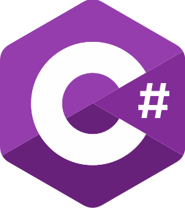

# Hello.

## About me:
- Actively maintaining 0 [projects](https://github.com/prokenz101?tab=repositories).

## Languages & Tools:

<a href="https://www.rust-lang.org/">
  <picture>
    <source media="(prefers-color-scheme: dark)" srcset="./media/rust_dark_mode.png" />
    <source media="(prefers-color-scheme: light)" srcset="./media/rust_light_mode.png" />
    
  </picture>
</a>

 
